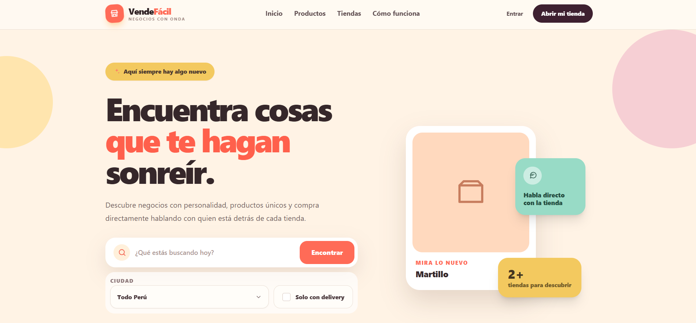

# VendeFácil

<p align="center">
  <strong>Marketplace para negocios locales, productos independientes y ventas directas por WhatsApp.</strong>
</p>

<p align="center">
  <a href="https://laravel.com"></a>
  
  
  
</p>

<p align="center">
  
</p>

## Descripción

VendeFácil es una aplicación web tipo marketplace creada con Laravel. Su objetivo es ayudar a pequeños negocios a tener una presencia digital sencilla: crear una tienda, publicar productos y recibir consultas de compradores directamente por WhatsApp.

El proyecto incluye una experiencia pública para explorar productos y tiendas, y un panel privado para que cada vendedor administre su negocio.

## Características

- Home público con buscador de productos y tiendas.
- Filtros por categoría, ciudad y disponibilidad de delivery.
- Página pública para cada tienda con sus productos activos.
- Ubicación de tienda con dirección, ciudad y acceso a Google Maps.
- Registro y login directo, sin verificación obligatoria de correo; recuperación de contraseña mediante SMTP configurable, incluido Gmail.
- Panel para vendedores con administración de tienda.
- CRUD de productos con imagen, precio, stock y categoría.
- Límite gratuito de productos y plan de productos ilimitados.
- Plan ilimitado de pago único por tienda, sin renovación mensual ni vencimiento programado.
- Subida de comprobantes de pago por Yape o BCP.
- Contacto directo por WhatsApp para tiendas y productos.
- Registro de clics a WhatsApp y visitas a tiendas.
- Panel de administración para revisar pagos, destacar, pausar o eliminar tiendas.
- Favoritos de productos y tiendas, denuncias y notificaciones dentro de la cuenta.
- Galerías de imágenes, horarios, redes sociales y enlaces para compartir tiendas.
- Diseño responsive con Blade, Tailwind CSS y Alpine.js.
- Carrusel de productos y categorías centralizadas en la sección de descubrimiento.
- Páginas de ayuda, condiciones de uso y privacidad, con contacto de soporte.
- Respaldos privados verificados de MySQL/SQLite, imágenes y comprobantes, con restauración y retención.
- Comprobaciones automáticas de PHP, vistas, frontend y restauración MySQL en GitHub Actions.

## Seguridad

El proyecto incluye varias medidas de seguridad aplicadas sobre la base de Laravel:

- Autenticación con Laravel Breeze.
- Hash seguro de contraseñas.
- Protección CSRF en formularios.
- Limitación de intentos en login, registro, reset de contraseña, zona privada y admin.
- Protección de rutas con `auth` y middleware `admin`.
- Comprobantes privados accesibles solo para su propietario o el administrador.
- Validación de imágenes por tipo, peso y dimensiones.
- Protección contra asignación masiva de campos sensibles como `is_admin`, `user_id`, `store_id` y `active`.
- Headers de seguridad: `X-Frame-Options`, `X-Content-Type-Options`, `Referrer-Policy`, `Permissions-Policy`, `Content-Security-Policy`, COOP y CORP.
- Sesiones cifradas y cookies `HttpOnly`/`SameSite`.

## SEO

El proyecto queda preparado para indexación y vista social:

- Títulos y descripciones optimizados para páginas públicas.
- Canonical URL para evitar duplicados.
- Open Graph y Twitter Cards para compartir mejor en redes.
- Datos estructurados JSON-LD para `Organization`, `WebSite`, búsqueda interna y tiendas.
- `robots.txt` dinámico con rutas privadas bloqueadas.
- `sitemap.xml` dinámico con portada, tiendas activas, ciudades y categorías con productos disponibles.
- `noindex` en login, registro, panel privado, perfil y administración.
- Imagen social en `public/images/seo/vendefacil-home.png`.

## Tecnologías

- Laravel 12
- PHP 8.2
- MySQL o SQLite
- Laravel Breeze
- Blade
- Tailwind CSS
- Alpine.js
- Vite
- Composer
- NPM

## Instalación Local

Clona el repositorio:

```bash
git clone https://github.com/Angel-ETECH/Vende-Facil.git
cd Vende-Facil
```

Instala dependencias de PHP:

```bash
composer install
```

Instala dependencias de frontend:

```bash
npm install
```

Crea el archivo de entorno:

Solo en una instalación nueva. Si ya tienes un `.env` configurado, consérvalo; `.env.example` es la única plantilla y nunca contiene tus claves.

```bash
cp .env.example .env
```

Genera la clave de Laravel:

```bash
php artisan key:generate
```

Configura tu base de datos en `.env`. Puedes usar MySQL:

```env
DB_CONNECTION=mysql
DB_HOST=127.0.0.1
DB_PORT=3306
DB_DATABASE=vendefacil
DB_USERNAME=root
DB_PASSWORD=
```

Ejecuta migraciones y seeders:

```bash
php artisan migrate --seed
```

Crea el enlace para imágenes públicas:

```bash
php artisan storage:link
```

Compila los assets:

```bash
npm run build
```

Levanta el servidor local:

```bash
php artisan serve
```

Luego abre:

```text
http://127.0.0.1:8000
```

## Comandos Útiles

Ejecutar frontend en desarrollo:

```bash
npm run dev
```

Reconstruir assets para producción:

```bash
npm run build
```

Limpiar cachés de Laravel:

```bash
php artisan optimize:clear
```

Ver rutas:

```bash
php artisan route:list
```

## Correo, Respaldos Y Publicación

El proyecto puede publicarse en cualquier servidor compatible con Laravel. Las credenciales reales se guardan únicamente en el `.env` de cada instalación.

- [Configuración y Gmail](docs/CONFIGURACION.md)
- [Respaldos, programación y restauración](docs/RESPALDOS.md)
- [Guía de publicación](docs/LANZAMIENTO.md)

```bash
php artisan vendefacil:backup
php artisan vendefacil:launch-check --local
```

Los respaldos diarios requieren activar el programador de Laravel en el servidor. La recuperación de contraseña requiere un proveedor de correo configurado y probado.

## Alojamiento De Prueba

Para probar el proyecto en InfinityFree, revisa la guía preparada en:

[docs/deploy-infinityfree.md](docs/deploy-infinityfree.md)

El proyecto incluye un `.htaccess` de raíz para que InfinityFree redirija las visitas hacia `public/` sin exponer directamente archivos sensibles de Laravel.

## Estructura Principal

```text
app/
  Http/Controllers/
  Http/Middleware/
  Models/
database/
  migrations/
  seeders/
resources/
  views/
  css/
  js/
routes/
  web.php
  auth.php
docs/
  images/
```

## Autor

Desarrollado por **Angel ETECH** como proyecto de marketplace para pequeños negocios y ventas por WhatsApp.

Repositorio: [Angel-ETECH/Vende-Facil](https://github.com/Angel-ETECH/Vende-Facil)
